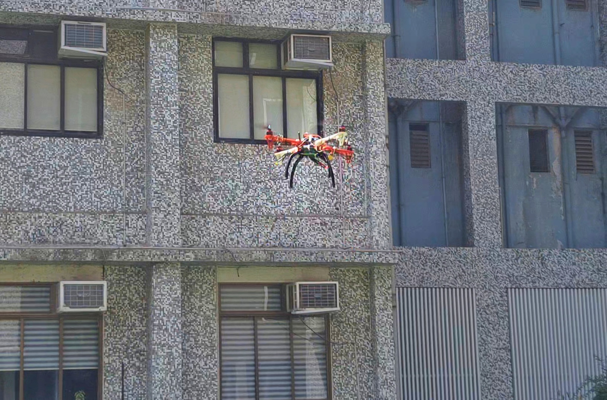
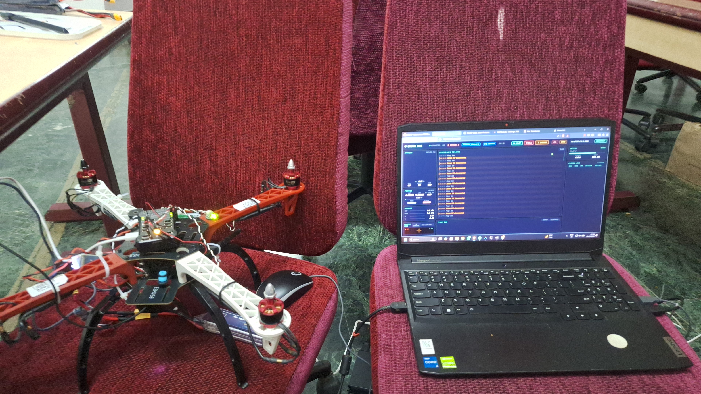
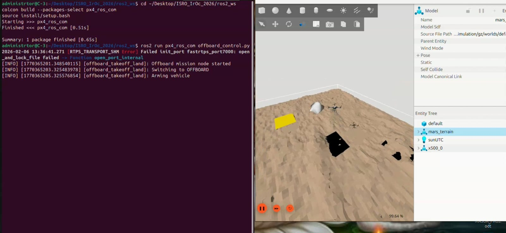

# ASCEND

<p align="center">
  
</p>

ASCEND is a drone systems engineering project developed as part of the ISRO Robotics Challenge (IRoC-U 2026) Autonomous Surveyor Challenge for Exploration, Navigation, and Dynamics (ASCEND). This repository documents the simulation environment, onboard software, ground control station, hardware integration, and VTHL (Vertical Takeoff, Hover, and Landing) workflows developed during the competition.


# Current Project Status

### Successfully Demonstrated

* Hardware Assembly and Integration
* PX4 Autopilot Integration
* ROS Integration
* Gazebo Simulation Environment
* MAVLink Communication
* Ground Control Station Development
* Sensor Integration
* LiDAR Altitude Estimation
* Telemetry Monitoring
* Camera Streaming
* Remote Arming / Disarming
* SITL (Software-In-The-Loop) Testing
* VTHL (Vertical Takeoff, Hover, and Landing)

### Competition Outcome

The project successfully qualified for Round 2 of the ISRO Robotics Challenge (IRoC-U 2026) and demonstrated VTHL capability through simulation and hardware validation workflows.


# System Architecture

<p align="center">
  
</p>

The ASCEND platform follows a companion-computer architecture in which the Ground Control Station, Jetson Nano, Pixhawk flight controller, onboard sensors, and communication systems operate together to support simulation, telemetry, flight control, and autonomous experimentation.

The Jetson Nano hosts the ROS environment and interfaces with onboard sensors, while the Pixhawk flight controller manages stabilization, state estimation, and low-level motor control through MAVLink-based communication.


# Engineering Highlights

This repository documents engineering work across multiple domains of the drone stack rather than focusing on a single subsystem.

Highlights include:

* Development of a PX4 + Gazebo simulation environment for autonomous drone testing.
* Integration of ROS-based software with Jetson Nano companion computing hardware.
* MAVLink communication between the companion computer and Pixhawk flight controller.
* Development of a custom Ground Control Station for telemetry visualization, image transfer, command execution, and flight monitoring.
* Integration of LiDAR, camera, telemetry, and onboard computing components.
* End-to-end system validation through simulation and hardware testing workflows.
* Successful demonstration of VTHL capability.

Detailed contribution information is available in:

```text
project_explainer/MY_CONTRIBUTIONS.md
```


# Project Components

## Hardware Platform

The physical drone platform consists of:

* S450 Quadcopter Frame
* Radiolink Pixhawk 2.4.8 Flight Controller
* NVIDIA Jetson Nano Companion Computer
* PX4Flow Optical Flow Sensor
* TF Mini Plus LiDAR
* Logitech Camera
* Holybro SiK Telemetry Radio
* TP-Link WiFi Module
* Electronic Speed Controllers (ESCs)
* Brushless DC Motors
* LiPo Power System

Detailed hardware documentation:

```text
hardware/HARDWARE_OVERVIEW.md
```


## Simulation Environment

The simulation environment was developed using:

* PX4 Autopilot v1.15.4
* Gazebo Harmonic
* ROS 2 Jazzy Jalisco
* QGroundControl
* Custom Drone Models
* Custom Mars Terrain Environment

The environment was used for:

* SITL Testing
* Sensor Validation
* Offboard Control Development
* VTHL Experimentation
* Flight Controller Validation


## Jetson Nano Stack

The onboard computing stack consists of:

* NVIDIA Jetson Nano (4 GB)
* Ubuntu 18.04 LTS
* ROS Melodic
* MAVROS
* MAVLink Communication

The Jetson Nano serves as the onboard companion computer and acts as the bridge between onboard sensors, the Pixhawk flight controller, and the Ground Control Station.


## Ground Control Station

A custom Ground Control Station was developed to support:

* Telemetry Monitoring
* Vehicle Status Visualization
* Camera Streaming
* Command Transmission
* Flight Logging
* Network-Based Communication
* Image Transfer

The Ground Control Station consists of frontend, backend, and communication bridge components.


# Software Stack

## Simulation Stack

| Component      | Version        |
| -------------- | -------------- |
| Ubuntu         | 24.04 LTS      |
| ROS            | ROS 2 Jazzy    |
| PX4            | v1.15.4        |
| Gazebo         | Harmonic       |
| Middleware     | Micro XRCE-DDS |
| Ground Station | QGroundControl |

## Hardware Stack

| Component          | Version          |
| ------------------ | ---------------- |
| Companion Computer | Jetson Nano 4GB  |
| Ubuntu             | 18.04 LTS        |
| ROS                | Melodic          |
| Communication      | MAVROS + MAVLink |
| Flight Controller  | Pixhawk 2.4.8    |


# Repository Structure

```text
ascend-autonomous-drone/
│
├── README.md
├── README_assets/
│
├── hardware/
├── simulation/
├── jetson_nano/
├── ground_control_station/
├── requirements/
└── project_explainer/
```

### Folder Overview

| Folder                 | Purpose                                                                |
| ---------------------- | ---------------------------------------------------------------------- |
| hardware               | Hardware documentation, component images, and system overview          |
| simulation             | Gazebo worlds, models, ROS 2 packages, and SITL environment            |
| jetson_nano            | Companion computer software, ROS packages, launch files, and services  |
| ground_control_station | Custom GCS backend, frontend, networking, and communication components |
| requirements           | Reproducible software and hardware requirements                        |
| project_explainer      | Architecture, contribution records, and supporting documentation       |


# Documentation

## Requirements

```text
requirements/
├── SIMULATION.md
├── JETSON_NANO.md
├── GROUND_CONTROL_STATION.md
└── HARDWARE.md
```


## Hardware Documentation

```text
hardware/HARDWARE_OVERVIEW.md
```

Contains:

* Hardware Components
* System Architecture
* Component Images
* Power System
* Sensors
* Communication Hardware
* Docking and Charging Hardware


## System Documentation

```text
project_explainer/SYSTEM_ARCHITECTURE.md
```

Contains:

* High-Level Architecture
* Sensor Architecture
* Communication Architecture
* System Design Documentation


# Media Gallery

## Hardware Integration Setup

<p align="center">
  
</p>


## Simulation Environment

<p align="center">
  
</p>


## Ground Control Station Demonstration

```text
README_assets/demonstration.mp4
```

Demonstrates:

* Ground Control Station Interface
* Telemetry Monitoring
* Image Transfer
* Flight Command Execution
* Vehicle Status Visualization


# Contribution Reference

This repository contains the complete engineering documentation, software artifacts, simulation assets, and integration work associated with the ASCEND project.

For a detailed breakdown of engineering responsibilities, subsystem ownership, integration tasks, and technical contributions, refer to:

[project_explainer/MY_CONTRIBUTIONS.md](project_explainer/MY_CONTRIBUTIONS.md)


# Disclaimer

This repository documents the engineering work, software systems, hardware integration, simulation environment, and validation workflows developed throughout the ASCEND project.

The repository focuses on demonstrated capabilities and documented system behavior. Features or competition objectives not successfully validated during development are intentionally omitted from performance claims.