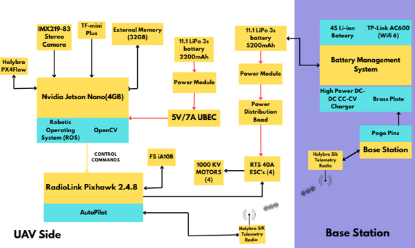

# ASCEND

ASCEND is a drone systems engineering project developed as part of the ISRO Robotics Challenge (IRoC-U 2026) Autonomous Surveyor Challenge for Exploration, Navigation, and Dynamics (ASCEND). This repository documents the simulation environment, onboard software, ground control station, hardware integration, and VTHL (Vertical Takeoff, Hover, and Landing) workflows developed during the competition.

## Repository Overview
```text
hardware/
simulation/
jetson_nano/
ground_control_station/
requirements/
project_explainer/
```

## System Architecture



The ASCEND platform follows a companion-computer architecture in which the Ground Control Station, Jetson Nano, Pixhawk flight controller, onboard sensors, and communication systems operate together to enable simulation, telemetry, flight control, and autonomous experimentation.

The Jetson Nano hosts the ROS environment and interfaces with onboard sensors, while the Pixhawk is responsible for flight stabilization and low-level motor control through MAVLink-based communication.