# ASCEND Hardware Overview

> This document provides a complete overview of the hardware used in the ASCEND (Autonomous System for Cooperative Exploration, Navigation, and Detection) platform.
>
> The ASCEND architecture is built around a dual-computer design where a Jetson Nano performs high-level perception and navigation while a Pixhawk flight controller handles real-time flight stabilization and motor control.

---

# System Architecture

<p align="center">
  
</p>

---

# Flight Platform

## S450 Quadcopter Frame

<p align="center">
  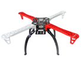
</p>

### Description

The S450 frame serves as the primary mechanical structure of ASCEND. It provides mounting locations for propulsion components, sensors, flight electronics, and the autonomous docking mechanism.

### Specifications

| Parameter     | Value                               |
| ------------- | ----------------------------------- |
| Frame Type    | S450 Quadcopter                     |
| Configuration | X Configuration                     |
| Wheelbase     | 500 mm                              |
| Material      | Carbon Fiber / Reinforced Composite |

### Purpose

* Structural support
* Component mounting
* Weight distribution
* Flight stability

---

# Propulsion System

## Brushless Motors

<p align="center">
  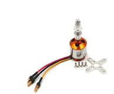
</p>

### Specifications

| Parameter | Value              |
| --------- | ------------------ |
| Type      | Brushless DC Motor |
| Rating    | 1000 KV            |
| Quantity  | 4                  |

### Purpose

The motors generate lift and provide roll, pitch, yaw, and thrust control.

---

## Electronic Speed Controllers (ESC)

<p align="center">
  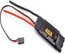
</p>

### Specifications

| Parameter      | Value          |
| -------------- | -------------- |
| Model          | ReadyToSky ESC |
| Current Rating | 40 A           |
| Quantity       | 4              |

### Purpose

ESCs regulate power delivered to each motor based on commands received from the Pixhawk flight controller.

---

## Propellers

<p align="center">
  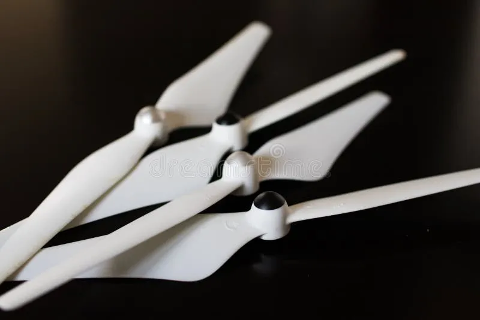
</p>

### Specifications

| Parameter | Value         |
| --------- | ------------- |
| Size      | 10 × 4.5 inch |
| Quantity  | 4             |

### Purpose

Convert motor rotation into thrust for flight.

---

# Flight Control System

## Radiolink Pixhawk 2.4.8

<p align="center">
  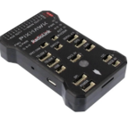
</p>

### Specifications

| Parameter     | Value         |
| ------------- | ------------- |
| Controller    | Pixhawk 2.4.8 |
| Firmware      | FMUv3         |
| Communication | MAVLink       |

### Responsibilities

* Flight stabilization
* Sensor fusion
* Motor control
* Failsafe handling
* Manual override

---

## FS-iA10B Receiver

<p align="center">
  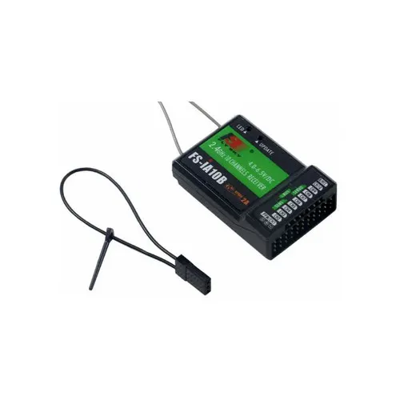
</p>

### Purpose

Provides manual control capability and emergency override functionality.

---

# Companion Computing

## NVIDIA Jetson Nano (4GB)

<p align="center">
  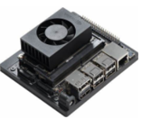
</p>

### Specifications

| Parameter | Value                  |
| --------- | ---------------------- |
| Platform  | NVIDIA Jetson Nano     |
| RAM       | 4 GB                   |
| Software  | ROS + OpenCV           |
| Storage   | 32 GB External Storage |

### Responsibilities

* Computer vision
* Visual Inertial Odometry (VIO)
* Sensor fusion
* Navigation
* Decision making
* MAVLink communication

---

# Sensor Suite

## IMX219 Stereo Camera

<p align="center">
  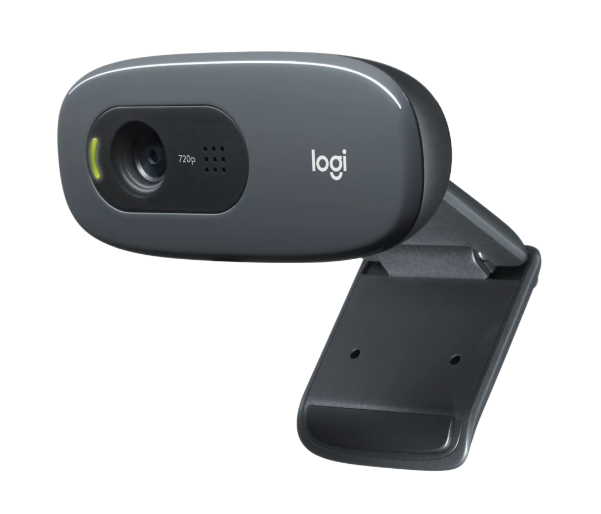
</p>

### Specifications

| Parameter  | Value |
| ---------- | ----- |
| Resolution | 8 MP  |
| Interface  | CSI   |

### Purpose

Used for:

* Visual Inertial Odometry (VIO)
* Feature tracking
* Navigation
* Environment perception

---

## PX4Flow Optical Flow Sensor

<p align="center">
  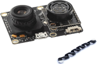
</p>

### Purpose

Measures ground-relative motion and improves hover stability in GPS-denied environments.

---

## TF Mini Plus LiDAR

<p align="center">
  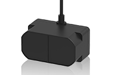
</p>

### Specifications

| Parameter | Value    |
| --------- | -------- |
| Range     | ~12 m    |
| Scan Type | 1D LiDAR |

### Purpose

* Altitude estimation
* Obstacle detection
* Environment awareness

---

# Communication System

## Holybro SiK Telemetry Radio

<p align="center">
  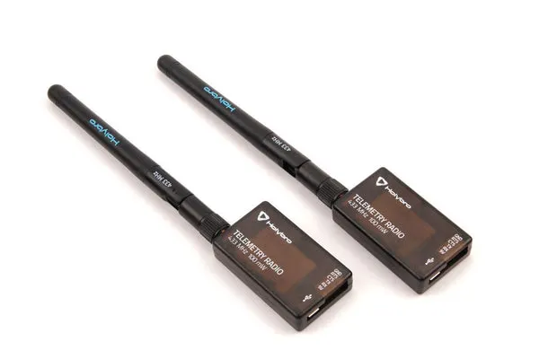
</p>

### Purpose

Provides long-range MAVLink communication between the drone and the Ground Control Station.

---

## TP-Link AC600 WiFi Adapter

<p align="center">
  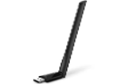
</p>

### Purpose

Provides high-speed wireless communication for:

* Log transfer
* Image transfer
* Ground station connectivity

---

# Power System

## Flight Battery

<p align="center">
  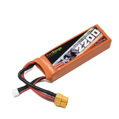
</p>

### Specifications

| Parameter | Value    |
| --------- | -------- |
| Type      | LiPo     |
| Cells     | 3S       |
| Voltage   | 11.1 V   |
| Capacity  | 5200 mAh |

---

## Power Distribution Board

<p align="center">
  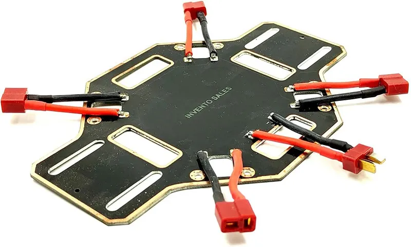
</p>

### Purpose

Distributes power from the battery to propulsion and onboard electronics.

---

## 5V / 7A UBEC

<p align="center">
  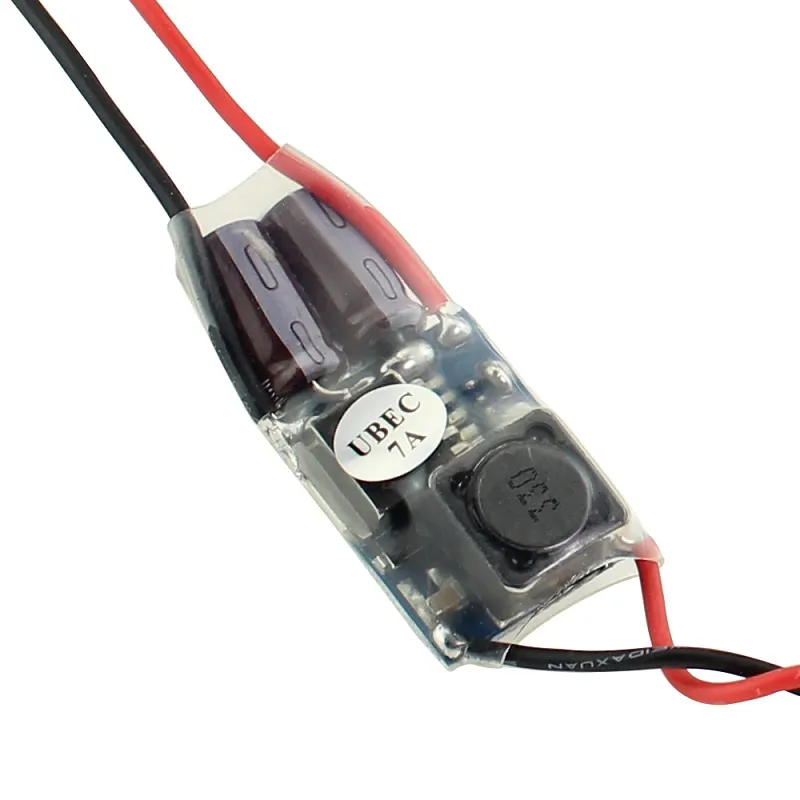
</p>

### Purpose

Provides stable power to the Jetson Nano and sensor suite.

---

# Autonomous Docking System

## Funnel Guided Docking Station

<p align="center">
  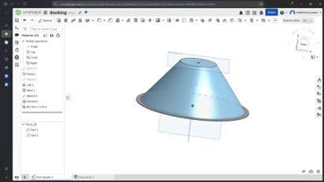
</p>

### Purpose

Guides the drone into proper alignment during autonomous landing.

### Components

* Funnel Dock
* Spring Loaded Pogo Pins
* Brass Contact Plate

# Hardware Communication Flow

```text
Camera
    │
PX4Flow
    │
TF Mini Plus
    │
    ▼
Jetson Nano
    │ MAVLink
    ▼
Pixhawk 2.4.8
    │
ESCs
    │
Motors
```

---

# Hardware Summary

The ASCEND platform combines autonomous navigation, onboard perception, MAVLink communication, autonomous docking, and automated charging into a unified UAV architecture. The hardware stack is designed to operate in GPS-denied environments while maintaining stable flight, reliable sensing, and repeatable mission execution.